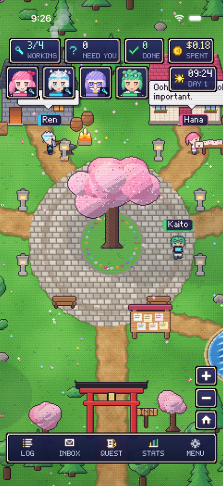
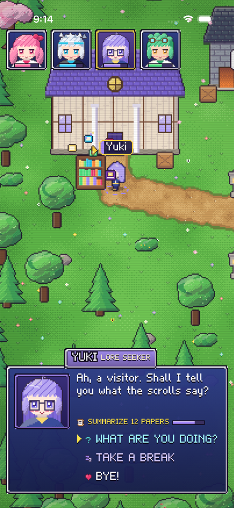
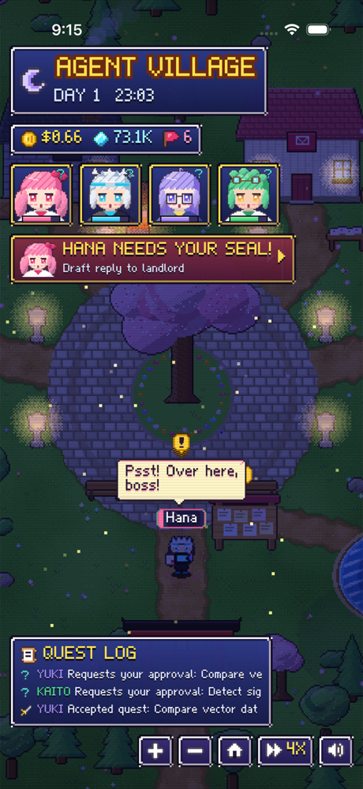
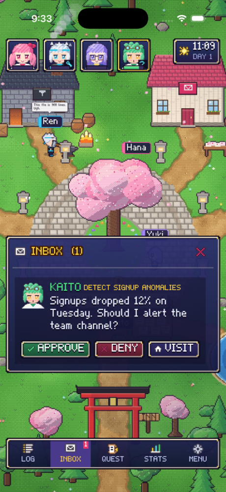
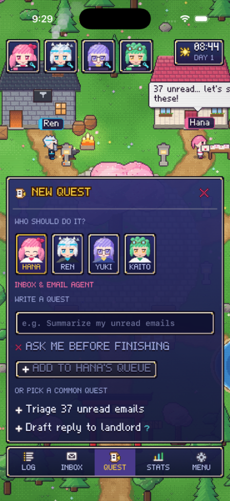
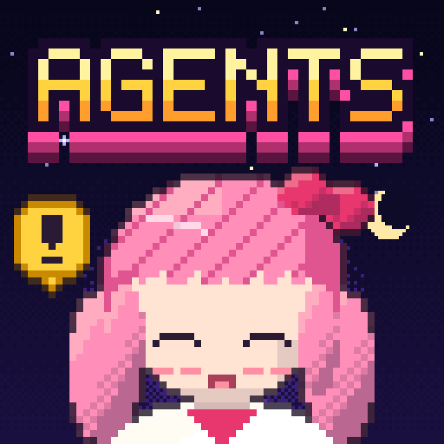

# Agent Village

**A pixel-art RPG dashboard for AI agents — for iPhone and Mac.**

Instead of a flat list of jobs and logs, your AI agents live in a little anime village. Each one walks to its workplace when it starts a task, shows what it's doing in speech bubbles, chats with the others in passing, and walks up to the Quest Board when it needs your approval.

<p align="center">
  
  
  
</p>

<p align="center">
  
  
  
  
</p>

## The agents

| Agent | Role | Workplace |
|---|---|---|
| **Hana** | Email (inbox triage, drafting replies) | Post Office |
| **Ren** | Mac operator & coder | Code Forge |
| **Yuki** | Research | Grand Library |
| **Kaito** | Data & files analysis | Star Observatory |

## Features

- **Living world** — agents path-find around the plaza, work at their stations with animated props (sparks at the forge, letters flying into the mailbox, orbiting magic books, a hologram chart), and chat when they bump into each other.
- **Human-in-the-loop approvals** — anything risky stops and waits for you. The agent walks to the Quest Board, the *Need You* counter pulses, and you approve or deny from the Inbox.
- **Assign your own quests** — pick an agent, type a task (or choose a common one), optionally require approval before it finishes. Each agent has a visible queue.
- **Dashboard panels** — Inbox, New Quest, Stats (per-agent work and usage), filterable Quest Log, Menu.
- **Day/night cycle** — lanterns and windows light up, fireflies come out.
- **Original chiptune audio** — a calm lo-fi loop and sound effects, synthesized in real time.

## How it's built

Everything is generated in code — there are no image or audio asset files besides the app icon.

- **SwiftUI + SpriteKit**, one multiplatform target for iOS and macOS.
- **Procedural pixel art** (`AgentVillage/Pixel/`): a small pixel canvas with auto-outlining, hue-shifted shading and Bayer dithering. Characters are hand-authored 16×24 palette-keyed sprites composed per agent (hair styles, outfits, expressions, walk cycles). Buildings, trees, the map and water animation are generated procedurally.
- **Custom bitmap font** — a hand-designed proportional 5×7 pixel font with word wrapping, used for all UI text and speech bubbles.
- **Real-time synthesizer** (`Game/Chiptune.swift`) — `AVAudioSourceNode` with pulse/triangle/noise voices, a sequencer for the music loop, and one-shot sound effects.
- **Simulation model** (`Model/`) — agent state machine (rest → walk → work → ask for approval → celebrate), waypoint routing around the plaza, encounters, quest queues and an event feed.
- `_archive_3d/` keeps the first prototype, a 3D RealityKit version of the village, before the project moved to pixel art.

## Real agents (Village Server)

The app can drive **real AI agents running on your Mac**. `server/village_server.py` (Python standard library only) runs each task with the **Claude Code CLI in headless mode**, so the agents use your Claude Code subscription — no API key or extra cost.

| Agent | What it really does | Tools |
|---|---|---|
| **Hana** | Reads, summarizes and drafts Gmail | Gmail via Claude's MCP connector |
| **Ren** | Runs tasks on your Mac: disk/battery checks, finding big files, organizing folders, scripts | Shell & files (read-only until approved) |
| **Yuki** | Web research with sources | Web search & fetch |
| **Kaito** | Analyzes files, folders and data on your Mac | Files, read-only shell, Python after approval |

**Safety:** agents plan with read-only permissions. Anything irreversible — sending email, changing files, running commands that modify the system — makes the agent stop and request approval. The villager walks to the Quest Board, you approve or deny in the Inbox, and only then does the server resume the same Claude session with broader permissions. `sudo` and destructive disk commands are always blocked.

**How it connects:** the phone finds the server on your Wi-Fi via Bonjour and authenticates with a pairing code. Progress streams over a long-poll event API, and each tool call becomes a speech bubble ("Searching: ...", "Reading your inbox...").

### Run it

```bash
claude            # once: run /login with your Claude account
python3 server/village_server.py
```

Then in the app: **MENU → YOUR MAC**, enter the address and pairing code it prints, and tap **CONNECT**. The HUD switches to **LIVE ON MAC**.

## Status & roadmap

- [x] Pixel-art village, HUD and dashboard
- [x] Approvals inbox, custom quests, stats, quest log
- [x] Real agents via a local Claude Code server: web research, Gmail, Mac tasks, with approvals
- [x] Live mode in the app: villagers act out real progress; readable reports
- [ ] Reach your Mac from anywhere (Tailscale) and auto-start the server at login

## Running the app

Open `AgentVillage.xcodeproj` in Xcode, pick an iPhone simulator, your own iPhone, or *My Mac*, and press Run. Requires Xcode 26+ (iOS 26 / macOS 26).

---

Built by **Syed Nabeel Raza**, pair-programming with Claude Code.
